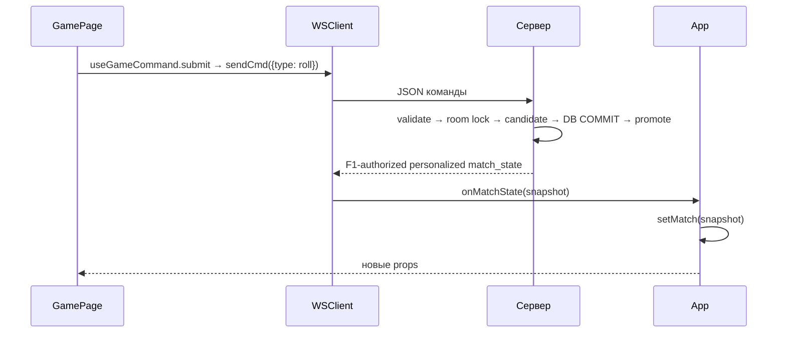

# Web клиент

[[React интерфейс]] · [[Стили и визуальные границы]] · [[Сервер и протокол]]

## Explicit lobby lifecycle — Room Lifecycle Phase 1

`LobbyPage` confirmation calls `WSClient.closeLobby`, a host-only epoch-0 correlated intent. Server `room_closed` calls App's `onRoomClosed` handler and returns to Home with a closure explanation. It clears current guest Continue and pending state; accounts remain signed in and may create another room. Disconnect/Back to home preserves valid recoverable ownership, while explicit closure revokes room credentials. Old socket callbacks and permanently refused reconnect cannot leave stale lobby controls. No Board3D/controller/gameplay changes. Implemented/focused-tested **2026-10-12**; complete verification/limits — [[Project State]], [[React интерфейс#Lobby closure — Room Lifecycle Phase 1]].

## Development server security — SEC-02

**Implemented/tested 2026-10-12:** [package.json](../../web/package.json) and its lock pin **Vite 6.4.4**; the existing React 18, React plugin 4.7.0, TypeScript and Node 24 remain compatible and unchanged. [vite.config.ts](../../web/vite.config.ts) binds normal dev and preview to **127.0.0.1**, preserving `/api` and `/ws` backend proxy behavior. Filesystem deny patterns cover `.env*`, CRT/PEM with query/NTFS suffixes and `.git`; `fs.strict` and upstream alternate-path checks remain enabled. This is development-server hardening, not a game/protocol/UI change. Production continues to serve Vite output through Nginx.

[viteSecurity.test.mjs](../../web/tests/viteSecurity.test.mjs) uses synthetic temporary roots/files only: actual listeners, dev/preview pages, direct/raw/NTFS/encoded paths, outside-allow-list/Wasm queries and configured HTTP proxy. All six groups pass on Windows; full web suite **275 passed**, TS/build/Docker build passed. Real Chrome additionally verifies two guests, regular Base start, actual FastAPI HTTP/WS proxy and Board3D GLBs. Version support, official advisory applicability, remaining audit findings and host limitations — [[Deployment#Vite development security — SEC-02]], [[Результаты аудита#SEC-02 Vite hardening — verified 2026-10-12]]. No real `.env`, private file or credential was probed.

## Fog frontend boundary — S2B-2B.3A

**Implemented/fixture-tested 2026-10-12:** optional public tile visibility/index and discovery reward event fields are typed; GamePage passes committed match tick/key/connection status to the shared BoardRenderer reveal lifecycle. Both SVG/Three consume sanitized public-only tiles, the same graph and controller. WSClient's existing room/match epoch and older-tick rejection is unchanged; refresh/reconnect establishes a presentation baseline. Gold Choose now uses existing ACK-correlated useGameCommand waiting and the same command envelope.

Public Fog is **DISABLED**: default backend snapshots/commands/legal/publication still reject it, and App's F2 LegacyMatchPage takes priority. This phase does not connect internal Python projection helpers to WS or change protocol VERSION/ownership/persistence. Browser [fog-rendering.cjs](../../web/e2e/fog-rendering.cjs) bundles a test-only public fixture entry, static assets and real UI/WSClient with a recorded synthetic transport; no backend/debug endpoint. Production entry/build never imports those fixtures. Verified 269 web/TS/production build; live Fog acceptance belongs to .3B. [[React интерфейс#Public Fog presentation — S2B-2B.3A]], [[plans/seafarers-fog]].

## Где начинается исполнение

[index.html](../../web/index.html) загружает [main.tsx](../../web/src/main.tsx). main монтирует App и импортирует styles.css.

App создаёт один WSClient через useMemo и хранит `room`, `match`, `status`, `error`, `log` и `closedLobby` для уведомления Home. В useEffect назначает callbacks и один раз запускает restoreCurrentGame. AudioProvider/AuthProvider окружают приложение. При F2 compatibility_required приоритет имеет LegacyMatchPage без игровых controls; иначе match показывает GamePage, отсутствие match — LobbyPage с Home/Host/Join/Recent/Active Games либо текущей комнатой. React Router не используется.

Текущий `defaultWebSocketUrl` в [wsClient.ts](../../web/src/wsClient.ts) выбирает **page-origin /ws**: protocol страницы определяет ws/wss, её host/port сохраняются. В обычном development запрос идёт, например, на ws://localhost:5173/ws; [vite.config.ts](../../web/vite.config.ts) проксирует `/ws` и `/api` в backend, по умолчанию на 127.0.0.1:8000. Это позволяет cookie auth использовать тот же origin. Production /ws и /api обслуживаются через Nginx.

Development `VITE_WS_URL` остаётся явным override browser URL и определяет backend для Vite proxy; отдельное прямое guest-подключение к ws://127.0.0.1:8000/ws возможно через Advanced connection. Этот адрес также служит fallback без page host, но не является обычным browser development default. **Historical — Infrastructure Phase 1, 2026-10-04:** direct-backend development default и 25 web cases описывали тот checkpoint; same-origin development proxy добавлен для Auth Phase 1. Настройка и ограничения — [[Deployment#Account cookies and HTTPS — Auth Phase 1]].

## WSClient

[wsClient.ts](../../web/src/wsClient.ts) — обычный TypeScript-класс, не React-компонент.

| Метод | Принимает | Действие |
| --- | --- | --- |
| connect | URL, имя | Создаёт WebSocket и назначает обработчики |
| host | Количество мест | Отправляет create_room или сохраняет намерение до подключения |
| join | Код комнаты | Отправляет join_room или сохраняет намерение |
| startMatch | — | Отправляет start_match |
| setMap | ID и/или JSON | Отправляет set_map |
| continueGame / restoreCurrentGame | Recent entry / URL и сохранённый pointer | Guest proof → verified reconnect; без fallback по имени |
| continueAccount | Код комнаты, имя, URL | account_continue; сервер определяет owned seat по cookie session |
| sendCmd | Объект игрового действия | Добавляет match_id, cmd_id, seq и сохраняет ожидающую команду |
| handleMessage | Строка JSON | Разбирает сообщение, меняет поля клиента и вызывает callbacks |

Методы не возвращают новое состояние игры. Оно приходит отдельным сообщением.

Historical verification 2026-10-02, Phase 1: персональный network view, consumed-seq/ACK/reconnect ordering проверялись прежним suite. Эти семантики сохранены, но 7 transport cases не являются сегодняшним числом тестов. **241 web passed, F2, 2026-10-08** и **757 Python passed, F3** — historical checkpoint results. Latest verified counts/границы — [[Project State]]. F1 защищает каждую private publication актуальным ownership; F2 подавляет playable match_state/commands для restricted rulesets, сохраняя Continue notice и ownership.

Выбранный инструмент/ship source/victim хранятся в useBoardInteraction, draft формы — в UI. Default BoardRenderer 3D и сохранённый SVG получают один state/controller. Баланс ресурсов и постройки приходят в committed персональном снимке. Полный путь — [[Сценарий сетевой партии]], состав UI — [[React интерфейс]].
